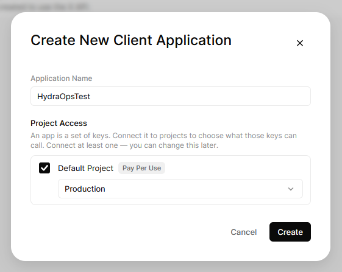
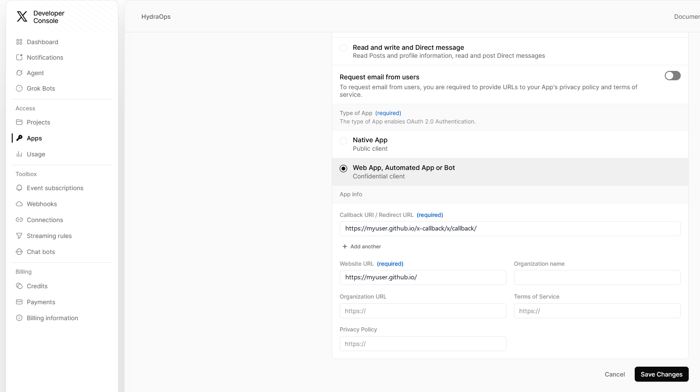
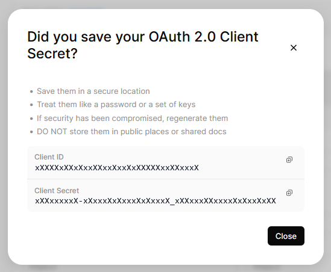

# Tools (integrations)

The **Tools** section in the sidebar connects HydraOps to external services. Don't confuse it with [Add-ons](./08-addons.md): an add-on is a tool the *agents use* (search the web, read a page); a tool in this section is a **connector** that lets you *operate HydraOps from the outside*.

Today there are **Telegram** (talk to your agents from your phone), **GitHub**, **[Hugging Face](#hugging-face-models-datasets-and-spaces)** (models, datasets and Spaces), **[Civitai](#civitai-models-trigger-words-and-example-settings)** (models, trigger words and example settings), **[Skills](#skills-know-how-for-the-agents)** (the know-how agents read when a task calls for it), **[Connections](#connections-ready-made-mcp-servers)** (apps and services the agents can drive) and **[X](#x-your-accounts-posted-to-with-your-approval)** (your X accounts). Discord, Signal and Reddit appear as "coming soon".

## Telegram: run your agents from your phone

With the Telegram bot you message an agent from your phone and get its reply, just like the chat inside the app.

### 1. Create the bot on Telegram

In Telegram, open a chat with **@BotFather** (the official bot that creates bots) and send `/newbot`. Follow the steps (a name and a username ending in `bot`). When it's done it gives you a **token** like this:

```
123456789:AAF-xxxxxxxxxxxxxxxxxxxxxxxxxxxxxxxxx
```

BotFather also gives you the link to your bot (`t.me/YourBot`). Keep it: that's where **you** will type, not in the BotFather chat.

### 2. Configure it in HydraOps

Go to **Tools → Telegram** and:

1. **Paste the token** in the field and press **Save**. The badge turns to "Token set". The token goes to HydraOps' key store outside the project, a file only your user can read (not encrypted) — never to the repository, the database or any `.env` (see [Security](./13-security.md)).
2. **Pick a default agent** (optional): with one set, plain messages go to that agent without having to name it.
3. **Generate a pairing code** with the button. It's a short number that authorizes whoever uses it.
4. **Enable** the toggle (ON). The bot starts listening within seconds, no restart needed.

### 3. Link your phone

Open **your** bot in Telegram (the `t.me/…` link from BotFather) and send:

```
/start <pairing code>
```

If the code matches, your account is authorized and you can talk to the agents. Anyone who isn't authorized can only try to pair: without a valid code, the bot ignores their messages.

### Commands

The bot uses **the same commands as the app's chat** (see [Commands](./15-commands.md)): `/agents`, `/use <agent>`, `/delegate`, `/tasks`, `/status`, `/remember`, `/recall`, `/crons`, `/cron`, `/pause`, `/resume`, `/run`, `/model`, `/tools`, `/grant`… with their Spanish aliases. Those that only make sense with the interface (`/oneshot`, `/close`, `/profile`, `/lang`, `/theme`) answer with a notice.

| You type | What happens |
|---|---|
| `/<agent> <message>` | Sends a one-off message to that agent (e.g. `/elena summarize this`) and the bot relays the reply. |
| `/use <agent>` | Sets this Telegram chat's active agent. |
| *plain text* | Goes to the active agent (or the default agent). |
| `/help` | Lists every command. |

Code comes back in a monospace frame, so a "hello world" asked of a coding agent reads cleanly on the phone.

### Access control

Since the bot is reachable by anyone who knows its username, access is controlled with an **allowlist** (the Telegram ids allowed to use it) plus the **pairing code**. You can edit the list by hand from the card — add or remove ids — and regenerate the code whenever you want; regenerating it stops the old one from pairing new users.

### Where the bot runs

The bot is just another service in the stack: it starts with the desktop app and with [server mode](./12-server-mode.md). For it to answer around the clock — from your phone, away from home — you'll want HydraOps running 24/7 on a server machine. Like every service, it shows up in the **System** view and writes its log to `storage/logs/telegram-bot.log`.

## Skills: know-how for the agents

A **skill** is a written procedure for one kind of work: how to do in-depth research, how to write a thread for X, how to audit a page's SEO. It is a folder with a `SKILL.md` file (the open [Agent Skills](https://agentskills.io) format, shared with other assistants) and sometimes reference files or templates.

Skills are **global**: installed once and used by every agent allowed to. An agent does not load the full text on every task: it sees only the name and description of each installed skill and opens the right one when a request matches. That keeps the prompt short, which local models notice.

### Per-agent permissions

Granted in each agent's **Agents → Tools**, like Telegram or web search:

| Tool | What it allows |
|---|---|
| `skills` | Seeing and using the installed skills. |
| `create_skill` | Proposing new skills. |

An agent without `create_skill` cannot create skills, even if it uses the existing ones. Agents with `create_skill` always get the **skill-creator** guide, which is included with HydraOps: it needs no install, cannot be deleted, and teaches them to write a skill in the right format. The **Skills** card shows which agents have each permission, and its **ON/OFF** button turns skills off for everyone.

### Installing from the catalog

The **Available** table reads the official catalog, the public [HydraOps-Skills](https://github.com/TraX22/HydraOps-Skills) repository. Each skill has a **View** button that shows its files and a **safety scan** before you install it: it flags phrases that try to take over the agent, credential file names, "download and run" commands, hidden text, or anything that looks like a key. **⬇ Install** downloads it and checks every file against the catalog's index; if they don't match, nothing is installed. When the catalog has a new version of an installed skill, **Update** appears, and **⟳ Check for updates** asks the catalog again.

Skills are text: HydraOps **never runs** any scripts a skill may include.

### Installing from GitHub

Any public GitHub repository that keeps skills in the same open format (a folder with a `SKILL.md`) is a source too: Unity's official skills, the lists the community maintains, a repository of your own. Paste its address in **Install from GitHub** and press **See what it holds**: the repository, one folder of it, or the `SKILL.md` itself (`https://github.com/owner/repo/tree/main/skills/my-skill`). Nothing is installed yet: HydraOps reads the repository and shows what it holds.

- A repository with many skills lists them with their description, files and size; copies kept for other agents under hidden folders (`.gemini/`, `.codex/`…) are left out, and a skill whose name you already have installed from elsewhere is marked. Pick the ones you want.
- One skill shows the summary: name, description, author and version from its `SKILL.md`, the repository's license and the one the skill declares, the files that will be installed and the ones that will not (an image, a file over the size limit), the **safety scan**, and a warning when the skill was written for an agent with a terminal: in HydraOps the agent translates those commands into the tools of its connections, and the ones that run code wait for your approval. You can read the whole `SKILL.md` before confirming.
- Source code a skill ships (`.cs`, `.cpp`, `.hlsl`, `.js`…) is installed as **read-only text**: the agent can open it as reference; HydraOps never compiles or runs it.

The installed skill keeps its origin: repository, branch or tag, commit and folder. Opening the Skills view asks GitHub, once per repository, whether that folder has moved on; when it has, **Update** reinstalls it from the same place, after the safety scan runs again. GitHub allows 60 of those questions an hour per computer without a token; a preview spends three, and viewing or installing what was just previewed spends none (the answers are kept for a few minutes).

HydraOps redistributes nothing: the skill comes from its author's repository, under the license the repository and the skill declare, and the preview shows both so you can decide.

### Installing by hand

You can also copy a skill by hand: the whole folder (with its `SKILL.md`) into the skills folder of your data:

| Setup | Folder |
|---|---|
| Windows (installed app) | `%APPDATA%\HydraOps\data\skills\` |
| macOS | `~/Library/Application Support/HydraOps/data/skills/` |
| Linux | `~/.config/HydraOps/data/skills/` |
| From source | `skills/` at the repository root |

The exact path is shown at the bottom of the card. The folder name must match the `name` in `SKILL.md` (lowercase letters, digits and hyphens). Skills copied by hand show as *copied by hand* and are deleted like any other.

### Skills the agents create

An agent with `create_skill` can propose a skill when it has worked out something worth repeating. The proposal **is not saved on its own**: it is held with an **Approve / Reject** card in the chat, in the **Installed** table (marked *awaiting approval*) and, if Telegram is set up, on your phone. Read all of it before approving: it will become instructions for every agent that uses skills.

Skills your agents create stay **on your computer**: they are not uploaded to any repository. An agent cannot change or replace a skill that already exists either.

Skills cannot be edited from the app yet: to change one, edit its `SKILL.md` in the folder, or delete it and install it again.

## Tools on demand

Every call to the model carries the definitions of the tools the agent may use, and with a couple of connections that is tens of thousands of tokens even when the request is one line. So when an agent has **more than 12 tools**, HydraOps does not send the definitions: it sends an index, the name and one line per tool grouped by connection, plus one more tool, `load_tools`, with which the model loads the full definition of the ones it is going to use in its next step.

To spare that loading round in the obvious cases, these start loaded:

- the tools you name in the message, by the connection's name ("Blender", "Comfy") or by the tool's own name ("run workflow");
- the ones the same chat used in its previous task;
- the calls a task resumes after an approval.

A loaded tool stays loaded for the rest of the task, called or not: the list of tools is the first thing in every request, and any change to it makes the provider read the whole conversation again at the full price instead of from its cache, which costs far more than a few idle definitions. The `load_tools` round does not count toward the agent's step limit. Approvals, the injection defense and the result vault work as before: only what the model sees before choosing changes. What each task loaded is kept with its data (`toolsOnDemand`).

It can be turned off in **Settings → Tools on demand** (or with `TOOLS_ON_DEMAND=off`). With 12 tools or fewer nothing changes.

## X: your accounts, posted to with your approval

HydraOps connects to **your own X developer app**, and through it to as many of your X accounts as you like: a project's, a brand's, a personal one. The agents publish on them with the `x_post` tool, and every post waits for your approval.

### 1. Your callback page

When you authorise an account, X sends the browser back to a **Callback URI** registered in your app, and X only takes **https** addresses there (not `localhost`, not `127.0.0.1`). HydraOps runs on your own computer, so the callback is a small page you host yourself: it receives the browser and forwards it to the HydraOps on that same computer (`http://127.0.0.1:3000`). It stores nothing and talks to no server; the code it carries is useless without the secret check HydraOps keeps.

Do this once:

1. In **Tools → X** press **Download the page**: you get an `index.html`. Reading this outside HydraOps? The same file is in the repository, [`ui/public/x-callback.html`](https://github.com/TraX22/HydraOps/blob/main/ui/public/x-callback.html) (use GitHub's download button and rename it `index.html`).
2. Publish it on any hosting with https. The example below uses **GitHub Pages**, which is free; any other hosting, free or paid, with its own domain or a free subdomain (Cloudflare Pages, Netlify, Vercel, your own website), works exactly the same: what counts is the final https address.
3. Write down the address where the page opens: that is your **Callback URI**.

With GitHub Pages:

1. Create a **public** repository, for example `x-callback`.
2. Upload the file inside the folders `x/callback/` (so the path is `x/callback/index.html`). Any folder works; this one makes the address easy to recognise.
3. In the repository's **Settings → Pages** choose **Deploy from a branch**, branch `main`, folder `/ (root)`, and save.
4. After a minute the page is at `https://<your-user>.github.io/x-callback/x/callback/`. That is your Callback URI, with the final slash.

Keep the host from logging full addresses if it lets you: the one-time code travels in the address (it expires in seconds and works only once, but it is better not kept anywhere).

### 2. Create the app in X's portal

X's API is pay-per-use: there is no free tier for new developers, you load credits in the portal and every operation deducts a little (about 0.015 USD per post, 0.20 USD when the post carries a link, 0.005 USD per post read, at the time of writing). One developer account and one balance serve every account you connect.

1. Sign up at [developer.x.com](https://developer.x.com/) with the X account that will own the app, create a project and an app, and load credits. The environment (Development, Staging, Production) is only a label: choose Production for the app you will use.

   

2. In the app's **User authentication settings** choose **Read and write**, the **Web App, Automated App or Bot** type, put your **Callback URI** from step 1 and a website address (your page's site works), and **save the changes**.

   

3. Copy the **Client ID** and the **Client Secret** (shown once).

   

4. In **Tools → X** paste the Client ID, the Client Secret and the **same Callback URI**, character for character (the final slash included), and press **Save**. They go to HydraOps' key store, never to the database or the repository.

The Callback URI saved in HydraOps must be exactly the one registered in the app you took the Client ID from: if they differ, X answers "Something went wrong" when you authorise.

### 3. Connect each account

Press **Connect an account**: HydraOps shows a link. Open it in a browser **on this computer**, signed in to X as the account you want to connect (switch accounts in X first if another one is open), accept the four permissions (read your profile, post, upload images, keep the session), press **Continue** on your callback page and come back: the account appears in the list within seconds, with its tokens in the key store, refreshed on their own.

When HydraOps runs on a server and your browser is elsewhere, the callback cannot reach it: your callback page shows the address with a **Copy** button, and the card has a field to paste it in. Same result.

An account can be connected again at any time (its tokens are replaced), and **Disconnect** forgets it.

### 4. Who may post where

Each connected account lists the agents allowed to post on it, and a new account starts with **nobody**: the publishing tool refuses, on the server side, any account the agent was not given here, so a post cannot land on the wrong brand by a model's mistake. Add agents with the picker on the account's row; the ON/OFF switch at the top pauses every account at once.

### 5. Posting

Give the agent the two tools in the Agents view (its tools list, like any other tool) and the account in Tools → X. Then ask it for a post or a thread as you would ask a person: "announce the 0.2 release on the HydraOps account, three posts, the link in the last one". The agent has two tools:

- `x_accounts` lists the accounts it may use. With one, it uses it; with several and a request that does not say which, it asks you; with none, it says so.
- `x_post` publishes one post or a thread (every part a reply to the one before) on one account, with attachments per part: up to 4 images, or one GIF, or one video (the files you dropped into the chat, by name; an MP4 with H.264 video and AAC audio, such as the ones ComfyUI makes). A video is uploaded in pieces and X processes it before the post goes out, so a post with a video takes minutes. It is held **every time**, whatever the task read: nothing goes out under your name without you.

The approval card shows the account with its avatar, every part as it will be published with its character count (280 weighted characters, a link counting as 23; 25,000 on an account you marked **X Premium** in the card), the images or the video, and the estimated cost; so does the Telegram notice. **Approve** publishes and the agent answers with the link; **Reject** drops it and the agent is told. There is no "approve for the rest of the task" for a post: each one asks.

The server publishes only the exact post you approved (same agent, account and parts), once; and it refuses, before anything reaches X, a part that is empty or over the limit, an account the agent was not given, an attachment that is not one of your files or is over X's size (5 MB for an image, 15 MB for a GIF, 8 GB for a video, 16 GB on a Premium account), a video or GIF mixed with other attachments, and anything while the switch is OFF. Deleting a post is not something the agents can do: that stays on X, with you.

## Hugging Face: models, datasets and Spaces

With the **huggingface** tools the agents work with the Hugging Face Hub the way the GitHub ones work with GitHub. Give an agent all of them with one line, `huggingface`, in its tools (**Agents → Tools**).

What runs on its own, because it only reads:

- `huggingface_search`: models, datasets or Spaces, filtered by task (text-generation, text-to-image…), library (gguf, transformers, diffusers…) or author, sorted by downloads, likes, trending or last update.
- `huggingface_repo_info`: license, size, base model, downloads, whether it is gated and whether your token has access to it.
- `huggingface_list_files`: the files of a repository with their sizes and direct download links, for instance to pick the GGUF quantization that fits your memory.
- `huggingface_read_file`: a card, a `config.json`, a chat template. Weights are not read.
- `huggingface_dataset_preview`: a dataset's columns and first rows, without downloading it.
- `huggingface_discussions`: a repository's discussions and pull requests.
- `huggingface_whoami`: which account the token belongs to and what it may do.

What waits for your approval every time:

- `huggingface_create_repo`: a model, dataset or Space repository, private unless you say otherwise.
- `huggingface_upload`: files of the task or that you attached, or text such as a README, in one commit (each file up to 10 MB; large weights are not uploaded yet).
- `huggingface_discuss`: open a discussion or comment on one.
- `huggingface_api`: any other Hub endpoint; reading (GET) runs on its own, anything else asks.

### The token

Public models, datasets and Spaces need no token. Add one in **Tools → Hugging Face** for what your account can see (gated and private repositories) and for writing. Create it at [huggingface.co/settings/tokens](https://huggingface.co/settings/tokens): **Read** is enough to read; **Write**, or a **fine-grained** token with the repositories you choose, to create and upload. The card shows the account it belongs to, or that Hugging Face refused it.

A gated model (FLUX.1-dev, Llama…) asks you to accept its terms once, on its page, signed in with the token's account; the agents cannot do that for you. Until then `huggingface_repo_info` says the token has no access.

The token lives only in the key store; the agents never see it. Their requests go through HydraOps' key proxy, which adds it only for Hugging Face and never follows a redirect to another site.

## Civitai: models, trigger words and example settings

With the **civitai** tools the agents study models on Civitai. Give an agent all of them with one line, `civitai`, in its tools. Civitai's API only reads, so they all run on their own:

- `civitai_search`: checkpoints, LoRAs, VAEs, ControlNets, upscalers, ComfyUI workflows… filtered by type, base model (Flux.1 D, SDXL 1.0, Pony, Illustrious…) or creator, sorted by downloads, rating, likes, hot or newest.
- `civitai_model_info`: a model's license (commercial use, credit, derivatives), its description and its versions, each with its base model, **trigger words** (what a LoRA needs in the prompt) and files: format, size, Civitai's safety scans, SHA256 and download link.
- `civitai_examples`: images people made with a version, with the **prompt, negative prompt, sampler, steps, CFG and seed** that made them, so the agent learns how a model is used before building a workflow with it.
- `civitai_identify`: which Civitai model a file you already have in ComfyUI is. The file's SHA256 is computed on your computer and looked up on Civitai; only files in the folders your ComfyUI lists are read.

Downloading a model is `comfy_download_model`'s job, which asks for your approval (see [Add-ons](./08-addons.md)).

### The key and adult content

Searching and reading need no key. Add one in **Tools → Civitai** for models that ask for a signed-in account. Create it in your Civitai account settings (**API Keys**) with only **Read** on **Models** and on **Profile & Settings** (the card shows the account with it); turn off every other permission, HydraOps uses none of them. It lives only in the key store; the agents never see it.

**Adult content is blocked** unless you allow it on the same card. Blocked, searches leave adult models and images out and a model marked adult is refused. The switch is HydraOps' own setting: the agents cannot change it, and if it cannot be read the content stays blocked. civitai.com and civitai.red answer the same API; HydraOps uses civitai.com.

## Connections: ready-made MCP servers

A **connection** is an MCP server that is already configured: Blender, a real browser, a document converter. It is what you could write by hand in [Add-ons → MCP servers](./08-addons.md), with the work done: how it is started, what your computer needs and, above all, **what each of its tools does** (its [`toolRisk`](./08-addons.md)). With that, the tools that only read run freely and the ones that change something are held for your approval only when they should be (see [Security](./13-security.md)), instead of everything asking for permission.

Connections come from the same public catalog as skills ([HydraOps-Skills](https://github.com/TraX22/HydraOps-Skills), the `presets/` folder). A connection is **configuration, not code**: installing one writes an entry in your MCP configuration and nothing else. The server program is published by a third party and fetched by the launcher it uses.

### What each one needs

Each connection uses the lightest launcher that works:

| Launcher | What it is | How to install it |
|---|---|---|
| `uvx` | Runs Python programs without installing them (comes with [uv](https://docs.astral.sh/uv/)) | Windows: `winget install astral-sh.uv` · macOS: `brew install uv` |
| `npx` | Runs Node.js programs (comes with [Node.js](https://nodejs.org/)) | Windows: `winget install OpenJS.NodeJS.LTS` · macOS: `brew install node` |
| `docker` | Only for servers that are not published any other way | [Docker Desktop](https://docs.docker.com/get-started/get-docker/) |
| `unity` | The [Unity CLI](https://docs.unity.com/en-us/unity-cli/use-unity-cli), Unity's own program, for the Unity connection | Unity Hub installs it · Windows: `winget install Unity.CLI` · macOS and Linux: `brew install --cask unity-cli` |

The catalog accepts no other command. **View** tells you whether the launcher is on your computer and, if it is missing, how to install it; it also lists what HydraOps cannot check (for example, that Blender is open with its add-on enabled).

### Installing and using one

1. In **Tools → Connections**, the **Available** table: **View** shows what it needs, the exact command it is started with and the classification of each tool. **Install** adds it.
2. Give it to an agent: in **Agents → Tools**, add the line the panel shows (the connection's name in lowercase, for example `blenderlab`). No agent gets a connection you did not give it.
3. That agent's worker connects it on its own within seconds. The **On this computer** table shows the state: *Connected*, *No answer · retried automatically* (the application was closed: open it, nothing needs restarting), *Connected · no tools · retried automatically* (the server runs but the program it drives is not open, Unity's editor for example: open it and the tools appear within a minute) or *No agent uses it yet*. **Reconnect** restarts a connection right away instead of waiting for that retry.

The tool classes:

| Label | Class | What happens |
|---|---|---|
| looks up | `neutral` | Runs freely and does not mark the task (the state of your own application). |
| reads outside | `read` | Runs freely; marks the task as having read third-party content. |
| changes | `acts` | Held for your approval if the task has already read third-party content. |
| reads and changes | `both` | Both. |
| always asks | `approve` | Every call waits for your approval, whatever the task read and whatever the security setting: code run inside the application (Unity's `eval`), a menu that can do anything. |

### Versions and updates

The program's version is **pinned inside the connection** (`uvx comfy-mcp==0.10.0`, `npx @playwright/mcp@0.0.83`): it is the one that was tested and classified. It does not change on its own. When the catalog publishes a new version of the connection, the *new version* label and the **Update** button appear; updating keeps the switch and the values you changed in the environment variables (a port, for example).

Some connections take a value of yours on their command line: the Unity connection is started with `--project-path {{UNITY_PROJECT}}`, where `{{UNITY_PROJECT}}` stands for the environment variable of that name. **View** lists the variables the connection ships and their values; an empty one is for you to fill in, in [Add-ons → MCP servers](./08-addons.md), after installing. Left empty, the argument is dropped together with its flag and the program uses its own default. The folders you name there (a project) count as places where the connection's tools leave their output: an image or a model a tool saves in them appears under the agent's reply. Only a file written while the task ran: an asset that was already there, such as a model a search listed, is the project's own and stays where it is.

If a server publishes a tool the connection does not classify, *N unclassified tools* appears: those are treated as the worst case (read and act) until a new version of the connection classifies them.

If you edited the command or the classification of an installed connection by hand, it is marked *edited by hand* and updating it asks for confirmation before overwriting your changes.

### The ones you set up by hand

The servers you added in Add-ons are listed under **On this computer** as *set up by you*, with their state and the agents that use them, but they are left alone here: edit and remove them in Add-ons (**Reconnect** works for them too). If the catalog has a connection with the same name, installing it asks before replacing yours.
