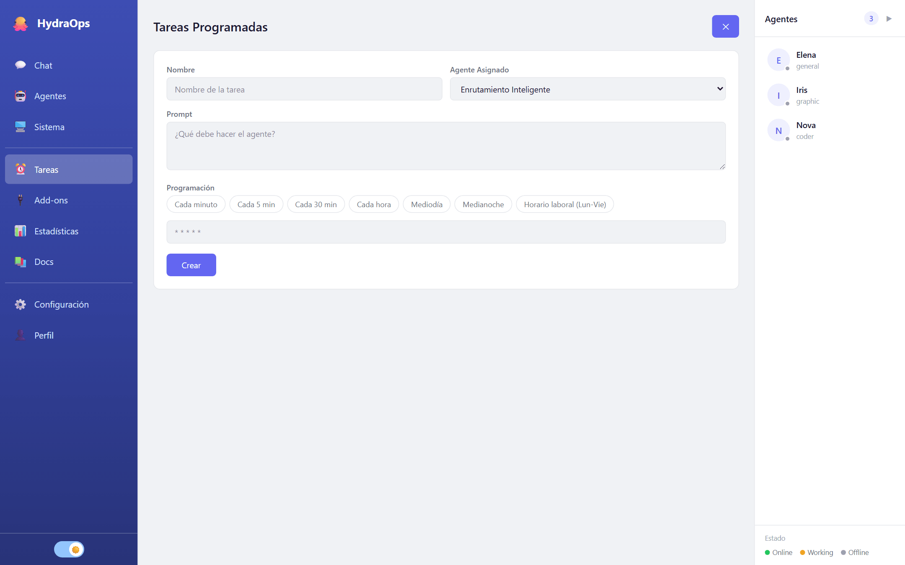

# Tareas programadas

La vista **Tareas** son los crons: tareas que se ejecutan solas, a la hora que digas, y cuyo resultado llega al chat como cualquier otro. "Cada mañana a las 8, resume las novedades de estos sitios" es una tarea programada.



## Crear una

Pulsa **Nueva Tarea**:

- **Nombre** — para reconocerla en la lista.
- **Agente Asignado** — quién la ejecuta. Una tarea programada siempre corre en un agente concreto.
- **Prompt** — qué debe hacer, escrito como se lo pedirías por chat.
- **Programación** — cuándo. Elegís la frecuencia y el resto se arma solo: **cada N minutos**, **cada hora** (en tal minuto), **todos los días** a una hora, **días de la semana** (con los días marcados) a una hora, **una vez al mes** el día tal, o **expresión cron** para lo que no entre en esas opciones. Los atajos (cada 5 min, mediodía, horario laboral…) siguen ahí, y debajo se muestra la expresión resultante. Una tarea existente se abre ya traducida a estas opciones.

También se crean desde el chat con `/cron <horario> <prompt>` (ver [Comandos](./15-commands.md)): abre este formulario precargado para que confirmes.

La expresión cron, para el modo manual:

```
┌ minuto (0-59)
│ ┌ hora (0-23)
│ │ ┌ día del mes (1-31)
│ │ │ ┌ mes (1-12)
│ │ │ │ ┌ día de la semana (0-6, domingo=0)
* * * * *
```

`0 8 * * *` = todos los días a las 8:00. `*/15 9-18 * * 1-5` = cada 15 minutos, de 9 a 18, de lunes a viernes.

## Gestionarlas

Cada tarea de la lista muestra su estado (**activa** / **pausada**) y se puede pausar, editar o borrar. El borrado pide confirmación escribiendo el nombre — un cron borrado por accidente no avisa hasta que echas de menos su resultado.

## Solo lo nuevo

Una tarea como "tráeme las últimas noticias de este feed" entregaría los mismos ítems cada vez. HydraOps lleva un registro, por tarea, de lo que hicieron sus ejecuciones anteriores: los **enlaces que entregaron** y **lo que decía cada página que leyeron**. El agente recibe los enlaces ya entregados antes de empezar, y después su respuesta la filtra la propia app, sin volver a preguntarle al modelo, antes de que te llegue (a ti o a tu Telegram):

- Si las páginas que lee la tarea dicen exactamente lo mismo que en una ejecución anterior, recibes una línea: sin novedades.
- Si no, se quitan los ítems cuyos enlaces ya se entregaron y sale solo el resto. Si no queda nada, recibes la línea.
- Una página que se volvió a leer y ahora dice otra cosa (un precio, un estado) no es una repetición: ese ítem se conserva.

El registro está hecho de enlaces, así que pide las fuentes en la tarea ("con el enlace de cada ítem"). Un ítem que viene con su enlace no se repite; uno sin enlace, de una página que sí cambió, no se puede distinguir de uno nuevo y sale como lo escribió el agente. Cada tarea programada lleva su propio registro, las ejecuciones que no encontraron nada no lo borran, y una ejecución fallida no cuenta como entregada.

## El calendario

Junto a los crons hay un **calendario**: entradas por fecha y hora que todos los agentes pueden leer y, con tu aprobación, escribir. Dos tipos:

- Una **nota** es contexto: una reunión, una entrega, "sin GPU hasta el 20". Toda tarea que corre un agente arranca con la agenda de hoy y de los próximos 7 días a la vista, así puede responder "¿qué tengo el jueves?", no programar dos cosas a la vez o escribir con el contexto del día. Una nota con hora te recuerda por Telegram cuando llega.
- Una **acción** es una tarea dejada para después: en su fecha y hora, el agente que indica recibe el prompt como tarea nueva en su chat, junto con los archivos que la acción reservó. "Thomas, publicá este hilo el viernes a las 10" es una acción. Si la tarea necesita una herramienta que pide aprobación (publicar en X, descargar un modelo), la pide en ese momento, como cualquier tarea.

Los agentes usan cuatro herramientas: `calendar_list` (la agenda entre dos fechas, con el id de cada entrada), `calendar_add`, `calendar_update` y `calendar_remove`. Agregar una nota es libre. **Programar una acción, cambiar una entrada o quitarla espera tu aprobación**, con una tarjeta como cualquier llamada retenida; aprobada, la acción corre a su hora sin volver a preguntar. Un agente puede cambiar tus propias entradas (con esa aprobación) pero nunca quitarlas.

Lo que el calendario garantiza:

- **La zona horaria viaja con la entrada.** Cada entrada guarda su zona (la tuya por defecto, que se fija con `POST /api/calendar/settings {"timezone": "…"}` hasta que salga la vista Calendario); un viaje o una máquina nueva nunca la corren.
- **Los adjuntos se conservan.** Los archivos que nombra una acción (tus adjuntos, los archivos de la tarea que la programó) se copian al calendario cuando la acción se aprueba, porque los archivos de una tarea se limpian al día. La tarea que corre después recibe las copias.
- **Repeticiones**: diaria, semanal, mensual, anual, hasta una fecha o hasta 365 veces; el 31 de un mes pasa a ser el 30 o el 28 cuando hace falta, nunca el 1 del siguiente.
- **Mientras HydraOps estuvo apagado**: una acción vencida hace 6 horas o menos corre al arrancar; una más vieja queda como perdida y te avisa por Telegram. Una nota con hora más vieja que eso ya no recuerda.
- **Lo de afuera se queda afuera.** Una entrada escrita por una tarea que había leído una página o un feed registra ese origen: queda fuera de la agenda que reciben los agentes, `calendar_list` la entrega marcada como contenido externo, y la tarea que dispara se trata como manchada, igual que una tarea delegada (ver [Seguridad](./13-security.md)).
- **Topes**: una tarea puede crear 20 entradas, un dueño puede tener 200 programadas, nada a más de un año. Alcanza para el uso real, no para un agente en bucle.

`GET /api/calendar?from=AAAA-MM-DD&days=14` lista las entradas; `POST`, `PATCH /:id` y `DELETE /:id` las gestionan desde tus propios scripts.

## Consejos

- Empieza con una programación frecuente (cada minuto) para probar que el prompt hace lo que quieres, y cámbiala después a la definitiva.
- El resultado llega al chat firmado por el agente: si programas muchas tareas frecuentes, el canal se llena — y cada ejecución consume tokens de tu proveedor.
- Recuerda que las tareas corren solo mientras HydraOps está encendido. Para que corran siempre, el [modo servidor](./12-server-mode.md) en una máquina 24/7.
- Si la tarea nombra sus fuentes (un feed, una página), el agente tiene que abrir al menos una en cada ejecución. Una respuesta escrita sin abrir ninguna se devuelve una vez; si la segunda tampoco las abre, la ejecución muestra un aviso en lugar de una respuesta que podría ser inventada.
